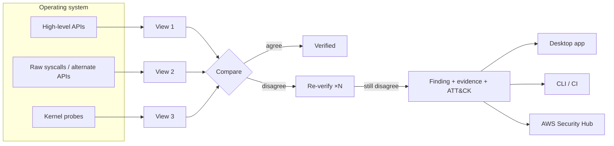

<div align="center">

<picture>
  <source media="(prefers-color-scheme: dark)" srcset="docs/brand/wordmark-dark.svg" />
  
</picture>

**Open-source, offline-first threat hunting for Linux and Windows.**
Finds rootkits, hidden processes, covert listeners and persistence by asking the operating system the same question through independent layers and flagging every disagreement.

[](LICENSE)


[Features](#features) · [Quick start](#quick-start) · [How it works](#how-it-works) · [AWS](#aws-security-hub-integration) · [CLI](#command-line) · [Docs](docs/) · [Contributing](CONTRIBUTING.md)

</div>

---

## Why Panoptic

Rootkits survive by lying to the tools defenders trust. `ps`, Task Manager and `netstat` all ask the same high-level APIs, so if those APIs are hooked, every tool is fooled at once.

Panoptic uses **Cross-Layer Truth Analysis**. Every artefact a rootkit might hide is observed through several independent layers of the operating system: high-level APIs, raw system calls and direct kernel probes. Any disagreement between them is reported.

| Surface | Layer 1: API | Layer 2: alternate path | Layer 3: kernel reality |
|---|---|---|---|
| **Processes · Linux** | libc `readdir(/proc)` | raw `getdents64` syscall | `tgkill(pid, pid, 0)` across the whole PID space |
| **Processes · Windows** | Toolhelp32 snapshot | `EnumProcesses` | `OpenProcess` on every PID (survives DKOM unlinking) |
| **Network** | `/proc/net/*`, `GetExtendedTcpTable` | — | `bind()` every port + `connect()` confirmation |
| **Kernel · Linux** | `/proc/modules` | `/sys/module/*/initstate` | kernel taint flags |
| **Kernel · Windows** | `EnumDeviceDrivers` | Service Control Manager | driver image on disk |

Before anything is reported, every discrepancy is **re-verified several times**. A process that merely started between two snapshots, or a socket that is bound but not listening, is never mislabelled as malicious.

## Features

**Detection**
- Hidden-process, hidden-listener and unlinked-kernel-module detection (the cross-layer core).
- **Persistence, 20+ mechanisms on each OS.**
  - Linux: cron, systemd, init scripts, shell profiles, `ld.so.preload`, XDG autostart, SSH keys, udev, PAM, and more.
  - Windows: Run keys, services, scheduled tasks, Winlogon, IFEO, AppInit/AppCert, LSA packages, COM hijacks, WMI subscriptions, and more.
- Process heuristics:
  - masquerading and typosquatted system binaries;
  - fileless `memfd` execution and deleted binaries;
  - LD_PRELOAD and injected libraries;
  - impossible parent/child relationships;
  - encoded PowerShell and LOLBin download cradles.
- Network heuristics: shells holding sockets (reverse shells), C2 ports, and raw/packet sockets used by passive backdoors.
- Integrity checks: kernel taint, test-signing, Defender tampering, hosts-file hijacks, and known rootkit artefacts.
- Every finding carries **evidence, a MITRE ATT&CK technique, a SHA-256 hash and a recommended response**.

**Experience**
- Guided **onboarding**: readiness checks, opt-in detections, opt-in automation and integrations.
- A sleek desktop app with dark/light themes, a command palette (<kbd>Ctrl</kbd>+<kbd>K</kbd>) and keyboard shortcuts.
- **9 languages**, including right-to-left Arabic: English, Español, Français, Deutsch, Português (Brasil), 日本語, 简体中文, العربية, हिन्दी.
- An interactive **MITRE ATT&CK coverage matrix** that highlights techniques detected in the current scan.
- Risk score, accepted-risk workflow, known-good **baselines with drift detection**, and scan history with a trend chart.
- Safe response: suspend, resume or kill a process, guarded against PID reuse and critical system processes.

**Operations**
- **Fully offline.** No telemetry, no accounts, no cloud dependency.
- **AWS Security Hub export** in the native ASFF format.
- **Scheduled background scans** through the OS's own scheduler.
- A headless **CLI** with CI-friendly exit codes. Exports to HTML, JSON, CSV, text and ASFF.
- Native installers: `.msi` / `.exe` (with an embedded WebView2, so they install offline) and `.deb` / `.AppImage`.

## Quick start

### Install

Download an installer for your platform from the [releases page](../../releases):
- **Windows**: `Panoptic_x64-setup.exe` or `Panoptic_x64_en-US.msi`
- **Linux**: `panoptic_amd64.deb` or `panoptic_amd64.AppImage`

Launch Panoptic and follow the onboarding. For full kernel-level coverage, run it as Administrator (Windows) or with `sudo panoptic` (Linux). When running as root, Panoptic keeps its data in the root-owned `/var/lib/panoptic`.

### Build from source

Prerequisites: [Rust](https://rustup.rs) (stable), Node.js 18 or later. On Linux you also need the WebKitGTK development packages:

```bash
sudo apt install libwebkit2gtk-4.1-dev libappindicator3-dev librsvg2-dev patchelf
```

```bash
npm install
```

```bash
npm run dev
```

```bash
npm run build
```

Installers are written to `target/release/bundle/`. On Windows, use the MSVC Rust toolchain for release builds; see [docs/BUILDING.md](docs/BUILDING.md).

## How it works



A deeper dive is in [docs/ARCHITECTURE.md](docs/ARCHITECTURE.md), and every rule is catalogued in [docs/DETECTIONS.md](docs/DETECTIONS.md).

## AWS Security Hub integration

Panoptic never connects to AWS and never handles credentials. Turn on the integration in **Settings → Integrations** (or during onboarding). Export findings via **Export → AWS Security Hub (ASFF)**, or from the CLI:

```bash
panoptic-cli scan --asff panoptic-asff.json --aws-account 123456789012 --aws-region us-east-1
```

Then import them with your own credentials:

```bash
aws securityhub batch-import-findings --findings file://panoptic-asff.json
```

- Findings are split into batches of 100, the per-call API limit.
- IDs are stable, so re-imports update existing findings rather than duplicating them.
- When `--aws-instance i-…` is given, findings attach to the EC2 instance resource.

Fleet patterns (SSM Run Command, EventBridge) are covered in [docs/AWS.md](docs/AWS.md).

## Command line

The installer bundles a headless `panoptic-cli` for servers, cron jobs and incident response.

Full scan with reports:

```bash
panoptic-cli scan --html report.html --json report.json
```

Capture a baseline on a clean host:

```bash
panoptic-cli scan --save-baseline baseline.json
```

CI or cron gate (exits 1 on High and above):

```bash
panoptic-cli scan --baseline baseline.json --fail-on high --quiet
```

Re-render a saved report:

```bash
panoptic-cli render report.json --csv findings.csv
```

Freeze a process for forensics:

```bash
panoptic-cli suspend 4242 --start-time 1761222000
```

| Exit code | Meaning |
|---|---|
| `0` | No unsuppressed finding at or above `--fail-on` |
| `1` | At least one finding at or above `--fail-on` |
| `2` | Error |
| `3` | Scan cancelled or partial |

## Project layout

```
panoptic/
├── crates/panoptic-core/   Detection engine (Rust library): engines, heuristics, ASFF, baselines
├── crates/panoptic-cli/    Headless scanner
├── src-tauri/              Tauri v2 desktop shell (commands, sidecar, installer config)
├── ui/                     React + TypeScript + Tailwind interface, i18n catalogs
├── scripts/                Build helpers (sidecar preparation)
└── docs/                   Architecture, detections, AWS, building, translating
```

## Privacy and safety

- Read-only by default. Panoptic never modifies persistence entries or system files.
- Process actions, scheduled-scan setup and exports happen only when you trigger them, each with confirmation.
- No network traffic leaves the host. The only connections are local `connect()` checks to this machine's own ports.
- Reports stay in your local data directory until you export them.

## Contributing

Contributions of every size are welcome: detections, translations, docs, and bug reports. Start with [CONTRIBUTING.md](CONTRIBUTING.md) and our [Code of Conduct](CODE_OF_CONDUCT.md). To report a vulnerability, follow [SECURITY.md](SECURITY.md).

## License

Copyright © 2026 Panoptic Contributors.

Panoptic is free software: you can redistribute it and/or modify it under the terms of the **GNU Affero General Public License, version 3** (`AGPL-3.0-only`), as published by the Free Software Foundation. It is distributed in the hope that it will be useful, but WITHOUT ANY WARRANTY; without even the implied warranty of MERCHANTABILITY or FITNESS FOR A PARTICULAR PURPOSE. See [LICENSE](LICENSE) for the full text.

In practice:
- **Use, study and modify:** you may use, study and modify Panoptic freely.
- **Distribute:** if you distribute it, modified or not, you must provide the corresponding source under the same license.
- **Network use:** if you let others use a modified version over a network (for example, as a hosted service), §13 of the AGPL requires you to offer them that modified source.

Third-party dependencies keep their own licenses (MIT, Apache-2.0 and OFL-1.1 for the bundled fonts), all of which are compatible with AGPL-3.0.

MITRE ATT&CK® is a registered trademark of The MITRE Corporation. AWS and AWS Security Hub are trademarks of Amazon.com, Inc. or its affiliates. Panoptic is an independent project and is not affiliated with either.
